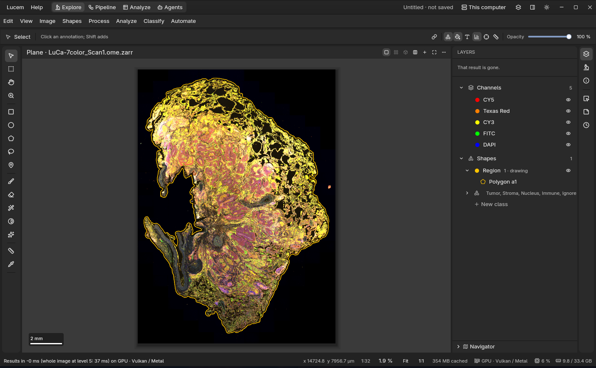

# lucem

GPU image analysis for histology and microscopy, written in Rust. Look at whole-slide and 3D
images, find tissue and cells, classify and measure them, build pipelines, and run the same
analysis headless over a folder of slides. Image operations are written once in
[CubeCL](https://github.com/tracel-ai/cubecl) and run on any GPU (Vulkan, Metal, CUDA, ROCm) or the
CPU; models run on [Burn](https://burn.dev); the desktop app is built on GPUI.

<picture>
  <source media="(prefers-color-scheme: dark)" srcset="assets/img/app/main-dark.png">
  <source media="(prefers-color-scheme: light)" srcset="assets/img/app/main-light.png">
  
</picture>

*`lucem-app` in Explore: a whole-slide multispectral scan (5 channels, 24960 × 34560 px) drawn
from its pyramid, a tissue region drawn on it. Sample image © PerkinElmer / Akoya Biosciences,
[CC BY 4.0](https://creativecommons.org/licenses/by/4.0/).*

> **Status:** early (0.0.1). It works and is tested, but not ready for production. Testers and
> contributors are welcome.

## What it does

- **Images:** OME-Zarr pyramids and common image files; whole slides and volumes read tile by
  tile, nothing at full resolution unless you zoom there.
- **Histology:** stain separation, tissue detection, cell detection and measurement (a threshold,
  or StarDist and Segment Anything as plugins), object and pixel classifiers, density maps,
  multiplexed phenotypes, superpixels, measurement tables.
- **Pipelines:** chains of GPU operations over tiles of large images, on a canvas in the app or as
  a JSON spec for the `lucem` command.
- **Sessions:** every step you take is recorded, and `lucem session run` replays it over many
  slides, headless.
- **Agents:** the app's commands are tools an agent can use (MCP): it sees the image, draws and
  names regions and runs steps, asking you before it changes anything.
- **Serving:** `lucem serve` serves images to enrolled clients over QUIC and TLS.

## Install

The library crates are on crates.io:

```bash
cargo add lucem          # the umbrella crate: core, io, ops, ml
cargo add lucem-hist     # histology workflows
```

The Python package is on PyPI, with the app and the model plugins as extras:

```bash
pip install lucem                # io, ops, your own functions over large images, the model client
pip install "lucem[hist]"        # + histology (lucem.hist)
pip install "lucem[app]"         # + the desktop app: `lucem app`
pip install "lucem[ml]"          # + the model plugins (StarDist, SAM); or lucem[stardist], lucem[sam]
pip install "lucem[all]"         # everything
```

The app and the command line build from this repository (they follow on crates.io once
kitchen-agent is published):

```bash
cargo run -p lucem-app --release     # the desktop app
cargo install --path app/lucem-cli   # the `lucem` command
```

## Crates and folders

| Path | Crate | What it is |
|---|---|---|
| `crates/lucem` | `lucem` | Umbrella crate: re-exports core, io, ops and ml |
| `crates/lucem-core` | `lucem-core` | Run-time choice of the CubeCL runtime (wgpu, CUDA, HIP, CPU), launch geometry, device arrays and memory reuse |
| `crates/lucem-io` | `lucem-io` | Readers and writers: OME-Zarr pyramids, common image files (TIFF, PNG, JPEG, …) |
| `crates/lucem-ops` | `lucem-ops` | GPU image operations: filters, morphology, thresholds, statistics |
| `crates/lucem-hist` | `lucem-hist` | Histology workflows: stains, tissue, cells, classifiers, density, phenotypes, exports |
| `crates/lucem-ml` | `lucem-ml` | The contract of the model plugins: manifests, protocol, discovery, client |
| `engine/lucem-pipeline` | `lucem-pipeline` | Chains operations on the device over tiles of large images |
| `serve/lucem-view` | `lucem-view` | Multiscale pyramids and display tiles |
| `serve/lucem-stream` | | Serving images over QUIC and TLS to enrolled clients |
| `hub/lucem-hub` | `lucem-hub` | Verified downloads and the local cache of model weights |
| `app/lucem-app`, `app/lucem-app-core` | | The desktop app (GPUI) |
| `app/lucem-cli` | | The `lucem` command |
| `app/lucem-mcp` | | lucem's tools for agents (Model Context Protocol) |
| `plugins/ml/lucem-ml-sam`, `lucem-ml-stardist` | | Model plugins: Segment Anything 2, StarDist (separate programs, their own licences) |
| `models/sam`, `models/stardist` | | The models the plugins run |
| `bindings/python/` | | Python package `lucem` (maturin, native module `lucem._native`) |
| `docs/` | | The documentation site |

## Toolchain

Rust stable (minimum 1.95, edition 2024). GPU runtimes need no toolkit for wgpu; CUDA and ROCm
use their drivers when present.

## Python (maturin + uv)
As in dsp-kitchen: `bindings/python/pyproject.toml` is the `lucem` package (maturin, native module
`lucem._native`, abi3 for CPython ≥ 3.12); `bindings/python/wheels/` builds `lucem-hist` (the same
extension with histology), `lucem-app` and the `lucem-ml-*` plugins (programs in wheels). See
[bindings/python/README.md](bindings/python/README.md). The root `pyproject.toml` is the development environment
(`lucem-dev`, not a package) and installs `lucem` from `bindings/python` in editable mode
(Python 3.13, `.python-version`).

```bash
uv sync                       # builds the Rust extension via maturin and installs it (editable)
uv run python -c "import lucem; print(lucem.__version__)"
uv run maturin develop --uv -m bindings/python/lucem-py/Cargo.toml   # rebuild after Rust changes (add --release for speed)
uv run pytest -q bindings/python/tests
cargo test --workspace        # Rust side (extension-module feature off)
```

## Licence

MIT or Apache-2.0, at your option. The model plugins carry their own licences (Segment Anything 2:
Apache-2.0; StarDist: BSD-3-Clause).
